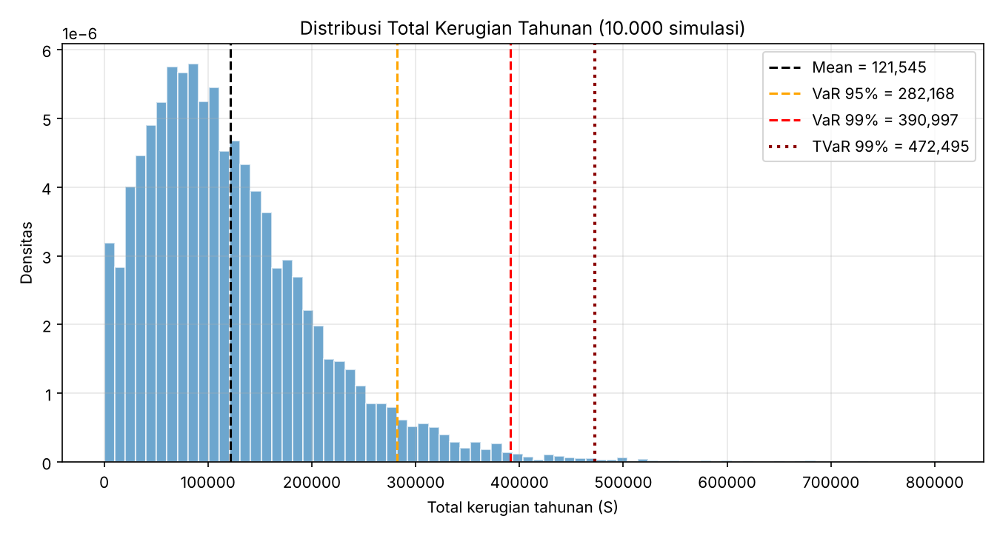
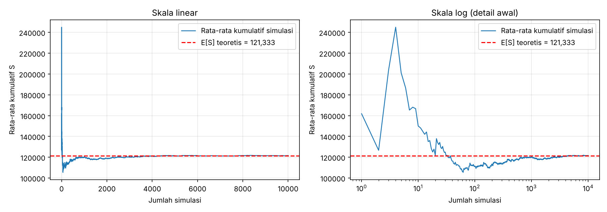

# Monte Carlo Insurance Loss Simulation

A personal actuarial project exploring aggregate insurance loss modeling using Monte Carlo Simulation, with Poisson claim frequency, Lognormal claim severity, and risk measurement through VaR and TVaR.

## Project Disclaimer

This repository contains a personal project as part of my individual learning journey and professional skill development in actuarial science.

This project is not intended to fulfill any university coursework, academic assignment, or formal research requirement. It serves as a practical exploration of insurance risk modeling, probability distributions, and Monte Carlo simulation using Python.

I recognize that this project may contain limitations in its assumptions, methodology, and implementation. Therefore, I warmly welcome suggestions, constructive criticism, and feedback from fellow learners, actuarial students, and professionals to help improve this project and my knowledge.

## Project Overview

The project simulates the **total annual claim cost** of an insurance portfolio:

```
S = X_1 + X_2 + ... + X_N        N ~ Poisson(λ),  X_i ~ Lognormal(μ, σ)
```

Each of 10,000 simulated "years" draws a random number of claims, draws a random size for each claim, and sums them. The resulting distribution of `S` is then used to estimate expected loss, volatility, Value at Risk (VaR) and Tail Value at Risk (TVaR).

## Background

An insurer's claims are uncertain in both **how many** occur and **how large** each one is. Pricing needs the expected loss; solvency and capital planning need to understand the **tail** of the loss distribution. The distribution of an aggregate (compound) loss rarely has a convenient closed form, so simulation is a practical tool.

## Objectives

- Build a transparent aggregate loss model in Python.
- Obtain the aggregate loss distribution via Monte Carlo simulation.
- Compute and interpret Expected Loss, Standard Deviation, VaR and TVaR (95% and 99%).
- Validate the simulation against closed-form moments of the compound Poisson model.
- Study simulation convergence and sensitivity to model parameters.

## Methodology

1. Specify assumptions and parameters.
2. Model claim frequency (Poisson) and claim severity (Lognormal) separately and check each against theory.
3. Combine both in an aggregate loss simulation (loop version for clarity, vectorized version for speed).
4. Validate against theoretical mean and variance: `E[S] = λ·E[X]`, `Var(S) = λ·E[X²]`.
5. Compute VaR and TVaR; analyze convergence across seeds and simulation sizes; run a parameter sensitivity analysis.

## Model Assumptions

| Component | Distribution | Parameter |
|---|---|---|
| Claim frequency | Poisson | λ = 4 |
| Claim severity | Lognormal | μ = 10, σ = 0.8 |
| Simulation | Monte Carlo | 10,000 iterations, seed 42 |

These parameters are **illustrative assumptions**, not estimates from real insurance data. Claim sizes are independent and identically distributed, independent of the claim count; no deductible, limit, reinsurance, inflation or discounting is modeled.

## Results and Visualization

Simulated vs theoretical moments (seed 42, 10,000 simulations):

| Metric | Simulation | Theory |
|---|---|---|
| Expected annual loss E[S] | 121,545 | 121,333 |
| Standard deviation | 84,862 | 83,546 |

Risk measures:

| Level | VaR | TVaR |
|---|---|---|
| 95% | 282,168 | 353,577 |
| 99% | 390,997 | 472,495 |





## Key Findings

- The simulation reproduces the theoretical mean within about 0.2% and the standard deviation within about 1.6%.
- The aggregate loss distribution is right-skewed (median 105,842 < mean 121,545; skewness ≈ 1.37).
- Roughly 3.2× the expected loss is needed to cover the 99% VaR; the 99% TVaR is about 81,500 higher than the VaR, showing how much the tail matters.
- Tail estimates are noisier than the mean: across 200 seeds, the 99% TVaR varied by about 2.3% versus about 0.7% for the mean. Using more simulations (e.g. 100,000+) is recommended for reporting.
- Increasing severity volatility (σ from 0.8 to 1.2) raises the 99% TVaR by about 2.7×, far more than it raises the mean (about 1.5×).

## Limitations

- Parameters are illustrative, not fitted to data.
- Independence assumptions; single homogeneous portfolio; single period.
- No policy terms (deductibles, limits) or reinsurance.
- Poisson frequency (mean = variance) and Lognormal severity may understate real-world dispersion and tail thickness.

## Future Development

- Fit frequency and severity distributions to real claims data (MLE, goodness-of-fit tests, QQ-plots).
- Compare Poisson vs Negative Binomial, and Lognormal vs Gamma / Weibull / Pareto.
- Add deductibles, policy limits and reinsurance (excess of loss, stop loss).
- Compare Monte Carlo results with Panjer recursion or other approximations.

## Repository Structure

```
monte-carlo-insurance-loss-simulation/
├── notebook/
│   └── monte_carlo_insurance_simulation.ipynb
├── data/
│   └── README.md
├── results/
│   ├── figures/
│   └── README.md
├── src/
│   └── simulation.py
├── README.md
├── requirements.txt
├── .gitignore
└── LICENSE
```

## How to Run

```bash
git clone https://github.com/natanaelnorimarna/monte-carlo-insurance-loss-simulation.git
cd monte-carlo-insurance-loss-simulation
pip install -r requirements.txt
jupyter notebook notebook/monte_carlo_insurance_simulation.ipynb
```

## Author and Feedback

Natanael Handi Rilus Norimarna, student at IPB University with an interest in actuarial science.
Suggestions and constructive criticism are welcome via GitHub Issues or pull requests.

## License

MIT License. See [LICENSE](LICENSE).
